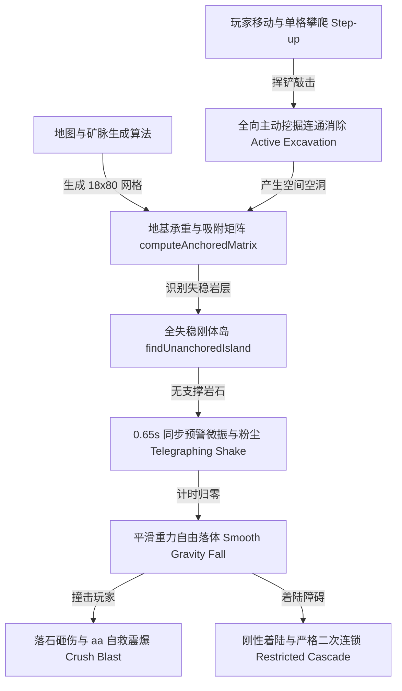

# 《苍白纪元：地心破晓》核心游玩算法与物理系统全景文档

> **文档版本**：v1.0  
> **基准代码参考**：2005 J2ME 原版反编译源码（`zdxz/b.java`, `zdxz/e.java`, `zdxz/f.java`）  
> **现代技术栈实现**：TypeScript + HTML5 Canvas 2D + Web Audio API（分辨率 18×80 宽屏高清网格）  
> **最后更新时间**：2026-10-18  

---

## 一、 算法体系架构总览

本项目的核心玩法引擎由 **8 大核心算法与物理状态机** 构成闭环：

---

## 二、 八大核心算法深度解析

### 1. 地形生成与矿脉相依概率算法
* **网格扩展**：从原版 J2ME 的 8 列 × 27 行大幅扩展至现代宽屏的 **18 列 × 80 行**（地表 4 行 + 地下 76 行深度）。
* **邻域相关矿脉生长模型**：
  * 对 4 种基础彩色矿石（极地纯冰、霜玉冻土、地热赤矿、日光金珀）采用双向继承概率生成：
    * 左侧同色继承率：$22\%$
    * 上方同色继承率：$38\%$
  * **效果**：自然汇聚生成 3~5 块天然成团的有机矿脉，彻底解决色块细碎散乱的问题。
* **耐久型障碍 8-邻域互斥隔离算法 (`hasAdjacentMultiHit`)**：
  * 3 击【数字岩石】（`HARD_ROCK`，出现率 4%）与 5 击【古代合金壁】（`ANCIENT_ALLOY`，出现率 1.8%）；
  * 生成时进行以自身为中心的 $3\times 3$ 范围碰撞探测，若邻域已存在多击方块则立即放弃；
  * **效果**：绝对杜绝水平或垂直出现连续的耐久铁板，彻底解决“三面堵死无路可挖”的卡关问题。
* **物证与钥匙深度埋设**：
  * 在 10m、18m、36m 地层埋设破案线索物证（琉璃瓦残片、开元通宝古钱、螭首残件）；
  * 在 26m、52m、68m 埋设地宫断龙闸信物钥匣；80m 地核祭坛埋设【始源传国玉玺】。

---

### 2. 多体地基承重与同色四向吸附算法 (`computeAnchoredMatrix`)
* **原版源码对应**：`b.java:690-710 as()` 与 `b.java:484-500 d()`。
* **接地基准（Ground Truth Anchor）**：
  * 严格遵循原版设计，**仅以第 79 行（深层地核基岩）作为唯一绝对受力固定锚点**；
  * 移除了地表人工硬编码锚点，确保下方被挖空时上方岩层能够真实发生自然塌陷。
* **BFS 承重泛洪状态机**：
  1. **垂直承重传导**：若网格 $(c, r)$ 处于稳固接地状态，则直接叠放在其正上方的非空方块 $(c, r-1)$ 自动获得刚性垂直承重，标记为 `anchored = true`；
  2. **同色四向侧向吸附（Adsorption）**：若方块 $(c, r)$ 稳固，其上、下、左、右四向相连的**同色基础矿石**通过 `canAdsorb()` 判定自动获得侧向刚性拉力吸附，即使下方悬空也绝不发生误下落。
* **效果**：完美呈现地下天然矿洞的倒挂晶岩、悬空彩桥与结构力学平衡。

---

### 3. 全失稳刚体岛与 0.65s 强力预警颤抖算法 (`findUnanchoredIsland`)
* **原版源码对应**：`b.java:247-252 ax()` 与 `b.java:2467-2490 a(fVar)`。
* **全失稳刚体岛聚类**：
  * 摒弃了单色搜索局限，通过 `findUnanchoredIsland()` 将所有纵向叠放、横向相邻的失去地基支撑的非空方块统一聚合为一个不可分割的**失稳刚体岛**。
* **0.65 秒同步预警状态机**：
  * 刚体岛内所有方块 $100\%$ 同步启动 `shakeTimer = 0.65s`（对齐原版 16 帧真实物理时间）；
  * **高频大幅横振**：左右振幅加大至 $\pm 3.5\text{px}$，纵向张力抖动 $\pm 1.0\text{px}$；
  * **金黄危险脉冲框**：四周高亮描绘 `rgba(255, 214, 0, pulse)` 呼吸光晕并在四角标红点；
  * **下落粉尘粒子 (`emitDust`)**：预警期间方块底沿持续掉落石屑粉尘，视觉预警极具威慑力。

---

### 4. 匀速平滑自由落体与像素级下坠插值算法
* **原版源码对应**：`b.java:253-262`（原版 4 帧子像素步长 `(b+1)&3`）。
* **状态机更新机制**：
  * 预警归零后转入 `tile.falling = true`；
  * 下落步进周期设为 $0.12\text{s}$，当下落一格时，新坐标位置赋上 `fallYOffset = -44px`；
  * 每一渲染帧以 $320\text{px/s}$ 的物理速度平滑插值恢复至 $0\text{px}$；
* **效果**：方块不再瞬移闪现跳格，而是如重石一般流畅滑落，运动轨迹肉眼清晰可辨。

---

### 5. 探险者砸伤判定与 `aa()` 震荡解困自救爆破算法 (`triggerCrushBlast`)
* **原版源码对应**：`b.java:2354`, `b.java:332-355`, `b.java:2297-2303`, `b.java:812-840 aa()`。
* **受击碰撞检测**：
  * 当自由落体方块步入角色所在网格 `(playerX, playerY)` 时触发。
* **惩罚与自救链条**：
  1. **体能扣减**：主角体能立即减少 $10$ 点（对应原版 `bL.a(7)` + 3 次 `bL.a(1)`）；
  2. **奋起挣脱**：短暂触发受击震屏与音效后，立即激活原版正统的 `aa()` 解困爆破；
  3. **3 列范围自救冲击波**：
     * 以主角为中心，向左向右延展 3 列宽（`col-1` 至 `col+1`）；
     * 纵向覆盖角色所在格及正上方 $3\times 2$ / $3\times 3$ 范围内的所有落石与彩色矿块；
     * 将这批落石全部瞬间气化炸碎，喷溅大量碎屑粒子并伴随重度爆炸音效。
* **效果**：彻底杜绝角色被落石挤死、卡进实心岩石缝隙中的物理 Bug，给玩家提供强烈的反击脱困快感。

---

### 6. 全向主动挖掘与集群连通泛洪爆破算法 (`excavate`)
* **原版源码对应**：`b.java:626-685 W()` 与 `b.java:1043-1067 s()`。
* **全向挖掘支持**：支持主角面向上、下、左、右各方向的主动瞄准与挥铲。
* **全状态同色连通泛洪 (`findConnected`)**：
  * 移除了错误排除 `falling` 状态的限制，无论是静止、预警还是刚失稳的方块，只要颜色相同，全部通过 4-向 BFS 纳入同一集群同时崩解；
  * 爆破时触发屏幕震颤（威力与集群大小成正比）、清脆多级破碎音效以及全向飞溅彩色粒子；
* **耐久型障碍敲击**：
  * 对数字石、合金壁与遗物箱单点递减耐久，显示表面残余耐久提示；耐久归零时起出历史物证。

---

### 7. 严苛防雪崩落地二次连锁消除算法 (`checkNewlyLandedCascades`)
* **原版源码对应**：`b.java:710-785`。
* **刚性着陆判定**：方块仅在下方遭遇障碍停下时才打上 `justLanded = true`，并仅将这批方块推入检测队列。
* **宽屏高清防雪崩双门槛**：
  * 针对 18 列宽屏进行数学平衡，必须同时满足：
    $$\text{Cluster Size} \ge 8 \quad \text{且} \quad \text{Freshly Landed Tiles} \ge 5$$
  * 杜绝任何“敲击一块导致全屏骨牌式自动连锁到底”的失控 Avalanche；
  * 只有发生大规模山体塌方撞入同色矿脉时，才会触发壮丽的史诗级撞击 Combo（附带金红全屏震颤与多倍得分）。

---

### 8. 角色站立、重力下坠与单格台阶越障算法 (`step-up`)
* **原版源码对应**：`b.java:2910-2950 D()/f()`。
* **单格站立力学**：角色只需脚下有 $1$ 个有效方块即可稳稳站立，无需双脚支撑。
* **单格跨步登顶（Step-up）**：
  * 水平移动时，若前方有 1 个方块阻挡，但该方块正上方为空位且角色头顶也为空位：
    * 角色自动平滑上登至该方块顶端，流畅跨过单格高差，无需频繁挥铲；
* **重力自然沉降**：脚下方块被挖除后，以 $0.08\text{s}$ 间隔平滑下落更新深度。

---

## 三、 核心代码模块索引

| 模块文件 | 职责定位 | 核心方法 / 常量 |
| :--- | :--- | :--- |
| [`Types.ts`](file:///Users/xiaoke/Documents/Codes/GitHub/dxyj/web/src/core/Types.ts) | 基础类型与物理常量定义 | `COLS=18`, `ROWS=80`, `TileType`, `CASCADE_MIN_CLUSTER=8` |
| [`GridEngine.ts`](file:///Users/xiaoke/Documents/Codes/GitHub/dxyj/web/src/core/GridEngine.ts) | 地形生成、受力矩阵与物理状态机 | `computeAnchoredMatrix()`, `findUnanchoredIsland()`, `updatePhysics()`, `triggerCrushBlast()`, `excavate()` |
| [`Player.ts`](file:///Users/xiaoke/Documents/Codes/GitHub/dxyj/web/src/core/Player.ts) | 探险者机动、挖掘与砸伤自救 | `tryMove()`, `dig()`, `onCrushedByRock()`, `update()` |
| [`CanvasRenderer.ts`](file:///Users/xiaoke/Documents/Codes/GitHub/dxyj/web/src/render/CanvasRenderer.ts) | 60FPS 平滑插值与微振特效渲染 | `renderTiles()`, `drawSingleTile()`, `fallYOffset` 像素位移插值 |
| [`ParticleSystem.ts`](file:///Users/xiaoke/Documents/Codes/GitHub/dxyj/web/src/render/ParticleSystem.ts) | 碎石、灰尘粉尘与金色星光粒子 | `emitBlockShatter()`, `emitDust()`, `emitSparkle()` |
