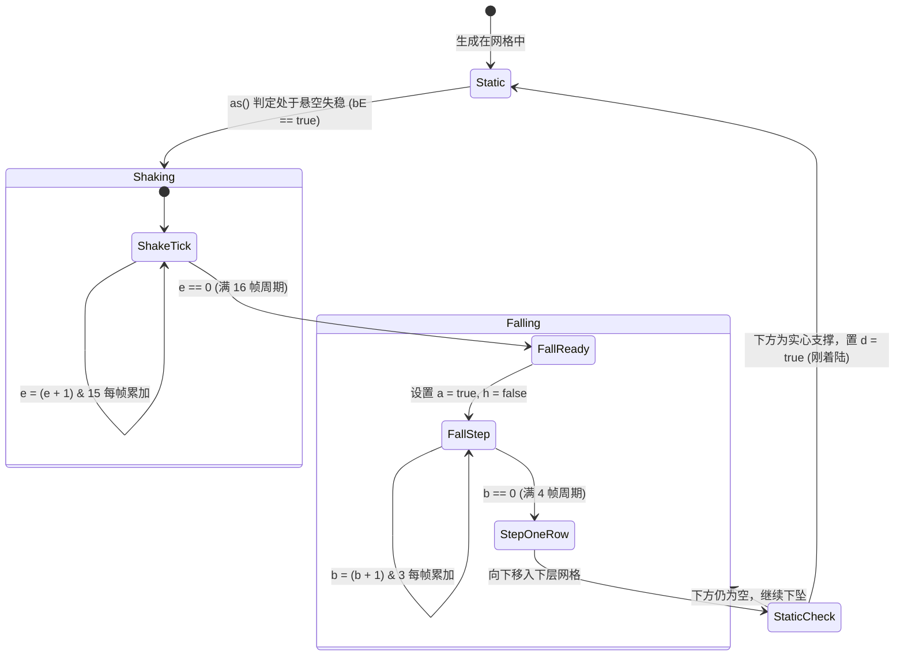
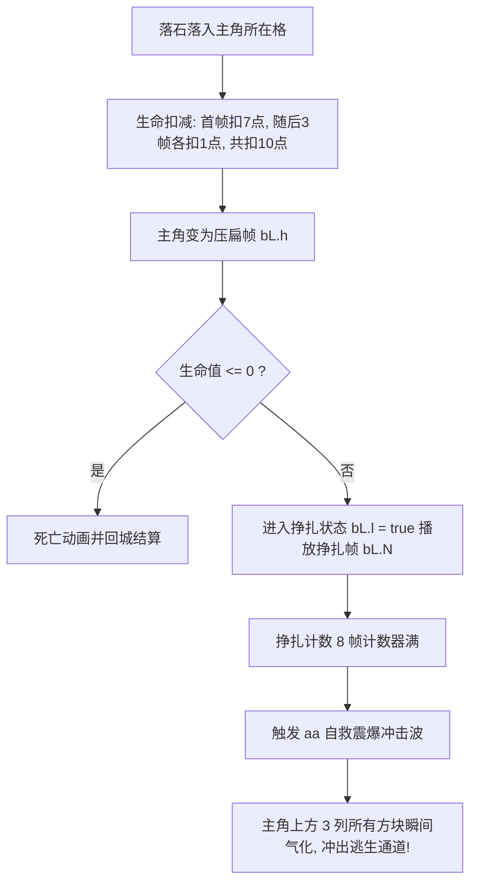

# 《原版地心探险（地心游记）》底层系统架构与核心算法全解析

> **文档性质**：原版 J2ME 项目逆向工程与技术解密终极全景白皮书  
> **源码基准**：2005 年原版 Java ME 反编译源码工程（`decompiled_src/sources/zdxz/`）  
> **核心类库**：`zdxz.java` (MIDlet入口), `b.java` (核心游戏引擎/Canvas), `e.java` (机体/主角实体), `f.java` (网格方块模型), `a.java` (弹道碎石粒子), `c.java` (定时器主循环驱动), `d.java` (静态数值与世界关卡数据库)  
> **成文日期**：2026-10-18  

---

## 目录
1. [系统总体架构与模块拓扑](#一系统总体架构与模块拓扑)
2. [核心类职责与数据结构定义](#二核心类职责与数据结构定义)
3. [引擎主循环与状态机时序管线](#三引擎主循环与状态机时序管线)
4. [八大核心算法与数学实现推导](#四八大核心算法与数学实现推导)
   - [算法 1：双缓冲无限纵向滚动与伪随机地质生成 (`F`, `S`, `e`)](#1-双缓冲无限纵向滚动与伪随机地质生成-f-s-e)
   - [算法 2：地基承重传递与同色/多击岩石四向吸附 (`as`, `d`, `u`)](#2-地基承重传递与同色多击岩石四向吸附-as-d-u)
   - [算法 3：16帧预警颤动与非均相刚体下坠状态机 (`ax`, `f.java`)](#3-16帧预警颤动与非均相刚体下坠状态机-ax-fjava)
   - [算法 4：主动定向挖掘与 4-向递归连通消除 (`W`, `s`, `c`)](#4-主动定向挖掘与-4-向递归连通消除-w-s-c)
   - [算法 5：严苛落地刚性检测与二次连锁爆炸 (`as`, `l`)](#5-严苛落地刚性检测与二次连锁爆炸-as-l)
   - [算法 6：落石砸伤判定与 `aa()` 垂直解困自救爆破 (`ar`, `aa`)](#6-落石砸伤判定与-aa-垂直解困自救爆破-ar-aa)
   - [算法 7：单格越障爬坡与重力自然沉降 (`D`, `f`, `p`)](#7-单格越障爬坡与重力自然沉降-d-f-p)
   - [算法 8：弹道物理破片与抛物线微重力粒子系统 (`a.java`, `aG`, `h`)](#8-弹道物理破片与抛物线微重力粒子系统-ajava-ag-h)
5. [道具法术机制与经济数值体系](#五道具法术机制与经济数值体系)
   - [八大属性水晶技能实现 (`s`, `R`, `j`, `at`, `bL.b`)](#八大属性水晶技能实现)
   - [20 级机体升级矩阵与 24 大世界关卡配置表](#20-级机体升级矩阵与-24-大世界关卡配置表)
6. [原版工程极致性能优化技法总结](#六原版工程极致性能优化技法总结)

---

## 一、系统总体架构与模块拓扑

2005 年由 BOOQIO（新浪无线代理发行）打造的 J2ME 平台神作《地心探险（地心游记）》，受限于当时功能机（如诺基亚 S60 平台，176×208 像素，堆内存通常仅 1~2MB，CPU 频率几十兆赫兹）的极限资源，采用了**极度紧凑、无垃圾回收（Zero-GC）、扁平化数组缓存**的高性能单线程架构。

### 模块拓扑关系图

```mermaid
graph TD
    subgraph MIDlet 容器层
        Z[zdxz.java<br/>MIDlet 宿主与生命周期]
    end

    subgraph 驱动与循环
        C[c.java<br/>TimerTask 定时驱动] -->|每帧调用 b.T()| B[b.java<br/>ConvKeyCanvas 引擎核<br/>4376行 巨型控制中枢]
    end

    subgraph 核心实体与物理模型
        B -->|管理主角状态| E[e.java<br/>机器人实体/装备/动画]
        B -->|27x8 屏幕网格| F[f.java<br/>方块物理状态数据模型]
        B -->|弹道破片队列| A[a.java<br/>抛物线重力碎石粒子]
    end

    subgraph 数据与存储层
        B -->|只读静态常数表| D[d.java<br/>关卡/升级/文本/三角函数表]
        B -->|RMS 存盘记录| RMS[(RecordStore<br/>'zdxz7')]
    end

    Z -->|启动构建| B
```

---

## 二、核心类职责与数据结构定义

### 1. `f.java`：方块物理状态模型（内存极致紧凑）
每个网格方块仅占用不到 20 字节的基本数据类型，无任何继承与多态：
```java
public final class f {
    public int f = -1;     // 方块类型 ID (-1: 空白, 0..3: 彩色矿, 4..8: 耐久岩石, 9..16: 水晶道具, 17..21: 金币遗物, 23..24: 基岩/终点, 25..28: 遗迹门)
    boolean h = false;    // 是否处于预警颤动状态 (isShaking)
    int e = 0;            // 颤动帧计数器 (16 帧循环: 0..15)
    boolean a = false;    // 是否处于自由落体下坠状态 (isFalling)
    int b = 0;            // 下坠子像素分频计数器 (4 帧步进: (b+1)&3)
    boolean d = false;    // 刚着陆标记 (justLanded，用于二次连锁判定)
    int c = 0;            // 辅助计数器
    int g = 1;            // 剩余敲击耐久度 (用于多击耐久岩石)
}
```

### 2. `b.java`：游戏核心引擎（核心数据字典）
| 字段标识 | 类型 | 内存含义与物理作用 |
| :--- | :--- | :--- |
| `i, G` | `int` | 屏幕分辨率：`176 × 208`（标准 Nokia S60 屏宽高） |
| `r` | `Image` | `176 × 208` 离屏主渲染缓冲（Offscreen Double Buffer） |
| `cs` | `Graphics` | 离屏主缓冲绑定的画笔绘图上下文 |
| `cc[27][8]` | `f[][]` | 核心游戏视口物理网格：纵向 27 行 × 横向 8 列，每个单元格 20×20 像素 |
| `bE[27][8]` | `boolean[][]`| **受力平衡/地基承重矩阵**：`false` 为稳固承重，`true` 为受力悬空失稳 |
| `q[216], l[216]` | `int[]` | 静态预分配 BFS 坐标队列（`q` 存行 `row`，`l` 存列 `col`），容量 $27 \times 8 = 216$，**完全杜绝动态 new 对象导致的 GC 卡顿** |
| `bS` | `int` | BFS 队列当前检索游标 / 集群计数器 |
| `bL` | `e` | 玩家所操纵的机器人单例实例 |
| `bW` | `int` | **主游戏状态机**：0=Logo开屏, 1=主菜单, 2=大地图选关, 3=关卡转场入场, 4=实际挖掘主玩法, 5=关卡初始化, 6=死亡/通关退出, 7=百叶窗转场, 8=剧情文字卷轴 |
| `cl` | `int` | 当前探险实际深度计数器（米数） |
| `bn` | `int` | 当前关卡目标深度米数（从 `d.o` 读取） |
| `bN[5]` | `int[]` | 当前地层生成的方块类型随机调色板（4 种彩色矿 + 1 种耐久岩） |
| `aY` | `Vector` | 飞溅破片粒子列表（元素为 `a.java`） |

### 3. `e.java`：探险机器人模型
- `c`：当前所在网格列号（$0 \sim 7$，开局居中为 4）
- `x`：当前在缓冲区中的行号（$0 \sim 26$，开局从 7 降落并恒定保持在视口中心 12 行）
- `I, J`：当前生命体力 / 最大体力上限（初始 100，升级后最高 200）
- `C`：累积金钱数（买装备、升级机体）
- `M[8]`：8 格水晶道具栏背包槽位计数器
- `j`：道具背包最大容量限制（初始 10，随升级最高 30）
- `n`：机器人机体升级等级（1 级至 20 级）
- `v`：攀爬/跳跃状态标记
- `G`：**被落石砸中扁平化状态（Squashed）**
- `l`：**被砸后奋力挣扎状态（Struggling）**
- `q`：左右平滑位移过渡状态
- `A[24][4]`：24 帧精灵动画精确像素锚点偏移量矩阵 `[srcX, srcY, offsetX, offsetY]`

---

## 三、引擎主循环与状态机时序管线

原版由 `c.java` 的 `TimerTask` 驱动，定时周期约为 $40\sim 50\text{ms}$，在 `bW == 4`（挖掘主玩法）状态下，每一物理帧严格执行如下管线顺序：

```mermaid
sequenceDiagram
    autonumber
    participant Loop as b.T() 主循环
    participant Player as ar() 玩家控制与状态
    participant Particles as aG() 弹道粒子更新
    participant Camera as ai() 视口滚动步进
    participant Anchor as as() 受力矩阵与连锁检测
    participant Falling as ax() 颤抖与重力步进
    participant Action as u() 输入指令派发

    Loop->>Player: 检查受击/移动/体力消耗/下落
    alt 玩家处于挣扎状态 (bL.l)
        Player->>Player: 挣扎计时 8 帧，归零时触发 aa() 解困震爆
    end
    Loop->>Particles: 遍历 aY 列表，执行微重力弹道并剔除出界粒子
    Loop->>Camera: 视口 4 帧平滑插值移动，更新深度 cl
    Loop->>Anchor: 重新计算 bE 承重矩阵，匹配四向同色吸附，执行落地二次消除
    Loop->>Falling: 16 帧预警计时 / 4 帧步进下落一行
    Loop->>Action: 响应按键 (挖掘 W, 移动 D/f, 背包)
```

### 核心物理循环源码对应关系（`b.java:2358-2368`）：
```java
if (this.bL.v || this.bL.x >= 12) {
    ar();   // 1. 玩家移动、被砸状态、体力自然消耗、下沉驱动
    aG();   // 2. 破片碎屑微重力粒子弹道位移与碰撞边界
    ai();   // 3. 镜头垂直滚动与换行触发
    as();   // 4. 地基稳固性泛洪、同色四向拉力吸附、落地连锁检测
    ax();   // 5. 16 帧预警颤抖计时、4 帧子像素步进下落
    u();    // 6. 响应按键输入 (转向、挥铲挖掘、单格攀爬、使用道具)
}
```

---

## 四、八大核心算法与数学实现推导

### 1. 双缓冲无限纵向滚动与伪随机地质生成 (`F`, `S`, `e`)
* **循环行环形平移**：原版地图并没有加载几百行的超长静态数组，而是始终维持 $27\times 8$ 的屏幕滑动窗口。当主角在视口中向下深入至 12 行时，触发视口滚动：
```java
// b.java:2754-2758
for (int i3 = 0; i3 < 26; i3++) {
    for (int i4 = 0; i4 < 8; i4++) {
        this.cc[i3][i4].a(this.cc[i3 + 1][i4]); // 整屏数据整体向上挪移一行
    }
}
```
* **底部第 26 行动态程序化生成（Procedural Generation）**：
  1. **深度终点判断**：若 `cl == bn`（到达目标深度），整行填满 `23`（金黄通关终点地基）；
  2. **古代遗迹闸门结构**：若到达遗迹层，在第 3、4 列生成双格石门部件：
     - `f(1)`：生成石门上半段 `25, 26`；
     - `f(0)`：生成石门下半段 `27, 28`；
  3. **阻绝层**：在特殊深度区间，整行生成 `24`（不可破坏的坚硬玄武岩）；
  4. **常规矿脉抽取**：使用 `(cu.nextInt() & 15) % af` 从调色板 `bN` 提取矿石与岩石类型；
  5. **道具与财富嵌入率**：通过 `cu.nextInt() & 31 + 1` 概率投掷：
     - $< 4$：生成水晶原石（类型 $9 \sim 16$）；
     - $5 \sim 6$：生成化石/古董/金块/钻石（类型 $18 \sim 21$）；
     - $7$：生成能量红水晶（类型 $16 \sim 17$）。

---

### 2. 地基承重传递与同色/多击岩石四向吸附 (`as`, `d`, `u`)
原版独特的“悬空彩桥”与“倒挂钟乳矿脉”并非程序 Bug，而是由其独特的受力吸附传递算法所支持：

#### 吸附相容准则判定方程 (`b.java:2682-2684 u()`)：
$$\text{CanAdsorb}(A, B) = \begin{cases} 
\text{true}, & \text{若 } A = B \text{ 且 } (A < 9 \lor A \in \{23, 24\}) \\ 
\text{true}, & \text{若 } 4 \le A \le 8 \text{ 且 } 4 \le B \le 8 \\ 
\text{false}, & \text{其他情况} 
\end{cases}$$
> **核心推论**：
> 1. **同色基础矿石**（$0 \sim 3$）在四向相邻时彼此产生分子张力吸附；
> 2. **所有不同耐久度的岩石**（$4 \sim 8$）被视为同构刚体，彼此相邻即可无缝侧向黏结！

#### 地基稳固性泛洪过程 (`as()`, `d()`)：
1. 先将 `bE[27][8]` 全局置为 `true`（全员预设悬空失稳）；
2. **绝对地基唯一定位**：以第 26 行（视口最底行）且 `f >= 0` 的非空方块作为唯一的受力固定地基，将其 `bE[26][col]` 置为 `false`（稳固）；
3. **四向同色吸附泛洪 (`d(row, col)`)**：
   从每一个已知稳固的方块出发，向**左、右、上、下**递归遍历相邻方块。只要邻居满足 `u(neighbor, current)`，该邻居立即获得稳固性（`bE = false`）；
4. **垂直刚性传递**：
   位于稳固方块正上方的任何非空方块，直接继承垂直向下的承重支撑，继续扩散其吸附网络。

---

### 3. 16帧预警颤动与非均相刚体下坠状态机 (`ax`, `f.java`)
原版物理引擎不使用连续浮点动力学，而是采用极度精准的**双阶段离散子像素分频状态机**：



* **预警颤动时间（Telegraphing）**：
  颤动累加器为 16 帧（`e = (e + 1) & 15`），以 25FPS 换算为 **$0.64 \sim 0.65\text{秒}$**。颤动期间渲染器对方块施加左右 $\pm 1\text{px}$ 的微小高频位移，为玩家提供危险逃逸反应窗口。
* **平滑下落分频**：
  当下落状态激活时，采用 4 帧子像素步进（`b = (b + 1) & 3`）。当 `b == 0` 时，方块正式下落一格（`i2 + 1`），下移后设置刚着陆标记 `d = true`。

---

### 4. 主动定向挖掘与 4-向递归连通消除 (`W`, `s`, `c`)
* **敲击耐久岩石 (`c(row, col)`)**：
  ```java
  // b.java:1069-1075
  public final void c(int i2, int i3) {
      this.cc[i2][i3].f++; // 耐久层级递进：4 -> 5 -> 6 -> 7 -> 8
      if (this.cc[i2][i3].f > 8) {
          this.cc[i2][i3].f = -1; // 满 5 击彻底破碎清空
          h(4, i3, i2);          // 爆裂碎石粒子
      }
  }
  ```
* **同色主动挖掘泛洪爆破 (`s(row, col)`)**：
  面向目标方块敲击时，触发 4-向四邻域深度优先搜索（DFS）：
  - 递归检测上、下、左、右方块；
  - 只要颜色相同，全部一次性标记清空为 `-1`；
  - 对每个消解位置调用 `h(type, c, r)` 喷射出 2 颗反向飞溅的彩色碎片粒子；
  - 每次有效挥铲恒定消耗主角 1 点体力（`bL.I--`）。

---

### 5. 严苛落地刚性检测与二次连锁爆炸 (`as`, `l`)
为防止大面积山体滑坡导致“无限制连环雪崩”，原版设定了严密的**落地方块二次消除闸门**（`b.java:760-784`）：
1. 必须是本次物理步进中**刚刚触底停稳的方块**（即具有 `d == true` 属性）；
2. 仅对该方块发起四向连通搜索 `l(row, col)`，统计其连通集团大小 `bS`；
3. **消除门槛**：
   $$\text{bS} > 3 \quad (\text{集群大小必须 } \ge 4 \text{ 格})$$
4. **消除结算**：若 $bS > 3$，整团方块发生聚爆碎裂，清空为 `-1`；若不足 4 格，则仅重置 `d = false`，使其成为坚固的承重地质。

---

### 6. 落石砸伤判定与 `aa()` 垂直解困自救爆破 (`ar`, `aa`)
这是原版最具救赎感、最精妙的容错防死机制：

#### 受击碰撞方程 (`b.java:2354`)：
当主角位于第 12 行，且当前坐标 `(x, c)` 的方块变为实体（`0 <= f <= 8`），且非跳跃下坠状态时，触发判定：
$$\text{CrushTrigger} = \text{true} \implies \text{bL.G} = \text{true}$$

#### 伤害与救赎流程：


#### `aa()` 震荡解困冲击波源码（`b.java:812-840`）：
```java
public final void aa() {
    int r = this.bL.x; // 主角行
    int c = this.bL.c; // 主角列
    // 覆盖自身列 c，以及左右相邻列 c-1, c+1
    // 从网格顶部 0 行一直炸到主角当前所在行 r
    for (int col = Math.max(0, c - 1); col <= Math.min(7, c + 1); col++) {
        for (int row = 0; row <= r; row++) {
            if (this.cc[row][col].f < 9) { // 炸碎所有基础矿石与耐久岩石
                e(row, col);              // 产生重度碎石爆炸粒子
                this.cc[row][col].f = -1;  // 方块瞬间气化
                this.cc[row][col].b();
            }
        }
    }
}
```
> **设计绝妙之处**：彻底规避了“落石将角色挤进实心方块导致碰撞体卡死”的物理死锁 Bug，同时给玩家带来置之死地而后生的极致感官冲击！

---

### 7. 单格越障爬坡与重力自然沉降 (`D`, `f`, `p`)
玩家在地心行进时，面对一格高的凸起障碍，无需频繁挥铲挖掘即可流畅穿行（`b.java:2921-2927`）：

* **Step-up 爬坡数学判定**：
  设主角当前位于 $(x, c)$，欲向左移动（$c - 1$）：
  1. 若前方 $(x, c - 1)$ 为实心受阻；
  2. 但前方上方 $(x - 1, c - 1)$ 为**空或可通过物**（`p(x-1, c-1)`）；
  3. 且主角头顶上方 $(x - 1, c)$ 也为**空**（保证有跃起抬头空间）；
  4. **结果**：自动提升高度，平滑攀登至该障碍物顶部（`s = -1, ci = 1, s = true`）。
* **重力沉降**：
  当主角脚下位置 $(x + 1, c)$ 被挖空或落石坠落时，立即启动重力沉降状态机（`ci = -1`），平滑下落一格。

---

### 8. 弹道物理破片与抛物线微重力粒子系统 (`a.java`, `aG`, `h`)
原版利用整数物理模拟出了极具冲击力的碎石飞溅效果（`a.java`）：

#### 运动学积分方程：
$$Y_{t+1} = Y_t + V_y, \quad X_{t+1} = X_t + D_x \cdot E_x, \quad V_y = V_y + 1$$
* **初始爆发冲量**：
  每个碎石生成时赋予初速度 $V_y = -7$（向上爆冲），随后重力加速度恒定为 $+1\text{px/frame}^2$；
* **横向随机发散**：
  $D_x \in [1, 8]$（随机速度），$E_x \in \{-1, 1\}$（随机左/右发散）；
* **边界剔除**：
  当 $X < 0 \lor X > 176 \lor Y > 208$ 时，从粒子列表中快速剔除。

---

## 五、道具法术机制与经济数值体系

### 八大属性水晶技能实现

所有水晶道具拾取后存入背包，在挖掘过程中按下 7/9 号功能键即可主动释放（`b.java:528-595`, `4353-4374`）：

| 水晶类型 | 道具名 | 触发方法 | 底层物理与数学逻辑 | 商店买价/卖价 |
| :---: | :---: | :---: | :--- | :---: |
| **0 号** | 红色水晶 | `s(0)` | 扫描当前屏幕可见视口（行 $x-4 \sim x+7$），**击碎全屏所有红色矿块** | $5000 / 2000$ |
| **1 号** | 黄色水晶 | `s(1)` | 扫描当前屏幕可见视口，**击碎全屏所有黄色矿块** | $5000 / 2000$ |
| **2 号** | 蓝色水晶 | `s(2)` | 扫描当前屏幕可见视口，**击碎全屏所有蓝色矿块** | $5000 / 2000$ |
| **3 号** | 绿色水晶 | `s(3)` | 扫描当前屏幕可见视口，**击碎全屏所有绿色矿块** | $5000 / 2000$ |
| **4 号** | 黑色水晶 | `R()` | 扫描当前屏幕可见视口，**击碎全屏所有数字岩石（$4 \le f \le 8$）** | $6000 / 3000$ |
| **5 号** | 闪亮水晶 | `j()` | 沿玩家所在列向下发射一道**激光射线**，直穿到底部基岩，打通垂直通道 | $8000 / 4000$ |
| **6 号** | 震荡水晶 | `at()` | 以主角为中心触发 $7\times 7$（半径 3 格）**全向地震球形爆破** | $8000 / 4000$ |
| **7 号** | 能量蓝水晶 | `bL.b(20)` | **瞬间修复机体，恢复 20 点生命体力** | $15000 / 8000$ |

---

### 20 级机体升级矩阵与 24 大世界关卡配置表

#### 机器人 20 阶升级属性总表 (`d.java:183 F`)：
$$\text{属性结构}：[\text{最大体力 } J, \text{ 背包容量 } j, \text{ 升级所需金币 } C]$$
```
第 1 级: 100 HP,  10 槽,      0 金 (开局预设)
第 2 级: 105 HP,  11 槽,  20,000 金
第 3 级: 110 HP,  12 槽,  30,000 金
第 4 级: 115 HP,  13 槽,  50,000 金
第 5 级: 120 HP,  14 槽,  50,000 金
第 6 级: 125 HP,  15 槽,  50,000 金
第 7 级: 130 HP,  16 槽, 100,000 金
第 8 级: 135 HP,  17 槽, 100,000 金
第 9 级: 140 HP,  18 槽, 100,000 金
第 10 级: 145 HP,  19 槽, 150,000 金
第 11 级: 150 HP,  20 槽, 150,000 金
第 12 级: 155 HP,  21 槽, 150,000 金
第 13 级: 160 HP,  22 槽, 200,000 金
第 14 级: 165 HP,  23 槽, 200,000 金
第 15 级: 170 HP,  24 槽, 200,000 金
第 16 级: 175 HP,  25 槽, 300,000 金
第 17 级: 180 HP,  26 槽, 300,000 金
第 18 级: 185 HP,  27 槽, 500,000 金
第 19 级: 190 HP,  28 槽, 700,000 金
第 20 级: 200 HP,  30 槽, 1,000,000 金 (终极究极钻地机)
```

#### 24 大世界探险地点配置表 (`d.java:181-182 Q, o`)：
| 编号 | 地点名称 | 深度要求 | 通关赏金 | 特殊机制 / 遗迹说明 |
| :---: | :--- | :---: | :---: | :--- |
| **0** | 普通海域 | 随机 100~400M | 5,000~20,000 | 基础练级区 |
| **1** | 普通陆地 | 随机 100~400M | 5,000~20,000 | 基础练级区 |
| **2** | 机器人研发基地 | 0M | 0 | 商业中心（买卖水晶道具、机体升级） |
| **3** | 新手杯挑战赛 | 100M | 15,000 | 初阶竞赛 |
| **4** | 勇者杯挑战赛 | 300M | 30,000 | 中阶竞赛 |
| **5** | 澳洲杯挑战赛 | 500M | 50,000 | 黄金海岸地下矿脉 |
| **6** | 太平洋杯挑战赛 | 200M | 40,000 | 海底地堑裂隙 |
| **7** | 自由女神杯挑战赛 | 700M | 75,000 | 纽约地下深层花岗岩 |
| **8** | 南美杯挑战赛 | 1000M | 100,000 | 安第斯地热层 |
| **9** | 大西洋杯挑战赛 | 400M | 80,000 | 深海沉积岩层 |
| **10** | 超级杯挑战赛 | 1200M | 125,000 | 超高压地幔层 |
| **11** | 海王杯挑战赛 | 600M | 120,000 | 海沟极深带 |
| **12** | 地心杯挑战赛 | 1500M | 150,000 | 超极限挑战赛 |
| **13** | 极限挑战（无限深度） | 无穷大 ($\infty$) | 0 | 自由无尽刷分模式 |
| **14** | 地下大陆入口 | 2500M | 200,000 | 主线封印断龙闸门 |
| **15** | 秦始皇陵 | 600M | 100,000 | 水银地宫与始皇帝秘宝 |
| **16** | 埃及地下古墓 | 600M | 80,000 | 法老金字塔地下墓穴 |
| **17** | 亚历山大大帝墓 | 500M | 50,000 | 远征帝王地下陵寝 |
| **18** | 亚特兰蒂斯古城 | 400M | 150,000 | 史前失落科技文明 |
| **19** | 成吉思汗墓 | 500M | 50,000 | 漠北密藏起辇谷 |
| **20** | 加勒比海盗宝藏 | 400M | 50,000 | 沉船金银岛地下金库 |
| **21** | 红衣主教的宝藏 | 400M | 50,000 | 中世纪宗教密藏 |
| **22** | 希特勒的宝藏 | 500M | 60,000 | 纳粹黄金地下密室 |
| **23** | 所罗门的宝藏 | 400M | 50,000 | 古代所罗门王圣殿矿藏 |

---

## 六、原版工程极致性能优化技法总结

通过深度剖析这 4,376 行 Java 源码，可以总结出 2005 年功能机时代顶尖商业开发者的 5 大极致性能设计法则：

1. **零垃圾回收设计（Zero Allocation in Loop）**：
   在整个 `T()` 帧循环物理步进中，没有任何 `new` 操作。所有的坐标队列（`q`, `l`）、矩阵（`bE`）、方块网格（`cc`）均在开局预先静态分配好，杜绝任何 GC 停顿引起的手机掉帧。
2. **原地状态偏移替代访问标记（In-place Visited Marking）**：
   在 DFS 泛洪消除时，原版没有分配额外的 `boolean visited[][]` 矩阵，而是极其聪明地使用 `cc[r][c].f -= 50`。只要数值变为负数，即代表“已访问”；完成统计后，再统一执行 `+= 50` 还原。内存占用为 0。
3. **查表法替代浮点运算（Integer Look-Up Tables）**：
   ARM 早期处理器缺乏硬件浮点加速单元（FPU），所有三角函数全部硬编码在 `d.i` 与 `d.R` 中，将正弦与余弦放大 1000 倍（如 $866 \approx 1000 \times \sin 60^\circ$）做纯定点整数运算。
4. **位运算与掩码极速取模**：
   所有帧动画与计数器全线采用二进制掩码：
   - `& 3` 替代 `% 4`（动画帧 0..3 循环）
   - `& 7` 替代 `% 8`（挣扎 8 帧计时）
   - `& 15` 替代 `% 16`（颤抖 16 帧预警）
   - `& 31` 替代 `% 32`（法术动画全周期）
5. **视口滚动环形复用（Sliding Window Viewport）**：
   仅维持 $27\times 8$ 的屏幕渲染视口，结合底部单行伪随机生长，以区区数百个对象的内存代价，完美模拟出了深达 $2,500$ 米的地心无穷世界。
